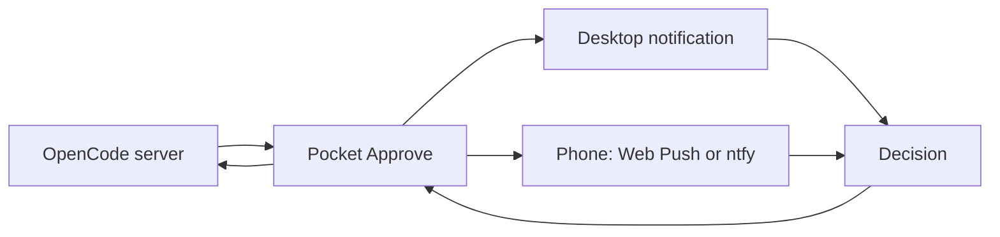

# Pocket Approve

Approve your coding agent from your pocket.

Pocket Approve watches OpenCode permission requests, sends them to your phone and desktop, and sends your decision back to OpenCode. The terminal stays available as a fallback. Pocket Approve never approves anything on its own.


## Status

The v2 notification path works end to end. A real OpenCode bash permission was approved from a phone, the command ran, and a repeated tap was rejected. Desktop notifications work on Linux with GNOME and gdbus. The automated suite has 292 passing tests.

Two delivery paths are supported:

- **Local Web Push** for phones on the same network, with a local CA and no external relay.
- **ntfy relay** for phones on any network, using a topic and HMAC-signed action links.

Desktop notifications currently target Linux and GNOME. macOS and Windows support is on the roadmap.

## What you get

- Permission prompts on your phone and desktop, from one shared queue.
- One-tap allow once, allow always, or deny.
- Replies sent back to the OpenCode session that asked.
- A desktop notification that disappears after you act on it.
- An audit log with a short trail of decisions.
- A terminal fallback when no phone or desktop is available.
- No silent approval. If nobody answers, the request stays pending.

## How it works



Pocket Approve polls each configured OpenCode server for pending permissions. New requests go to the desktop notifier, Web Push subscriptions, or an ntfy topic. When a decision arrives, Pocket Approve replies to OpenCode with the original request ID.

### Local Web Push

The server binds to your LAN address and serves the phone app over HTTPS with a local CA. The phone subscribes to Web Push and receives prompts even when the app is closed. No public relay is involved.

### ntfy relay

`npm run connect` starts a client that watches OpenCode directly and publishes prompts through [ntfy.sh](https://ntfy.sh) or a self-hosted ntfy server. The QR code contains the topic and the action links use HMAC signatures, so the topic acts as a secret.

The ntfy path is a relay. **ntfy.sh can read the notification content.** The HMAC protects the action links, not the message body, and this project does not use ntfy end-to-end encryption. Use a self-hosted ntfy server if the command text is sensitive.

## Requirements

- Linux with GNOME 50.1 or newer and `gdbus` for desktop notifications.
- Node.js 20 or newer.
- OpenCode 1.19 or newer.
- For local Web Push: a phone with a modern browser on the same network, plus a one-time CA install.
- For ntfy: the ntfy app on Android or iOS, and network access to your ntfy server.
- `OPENCODE_SERVER_PASSWORD` if your OpenCode server requires authentication.

## Install

```bash
git clone https://github.com/engida32/pocket-approve.git
cd pocket-approve/pocket-approve
npm ci
```

## Quick start with ntfy

Start your OpenCode server, then run:

```bash
npm run connect
```

Scan the QR code with the ntfy Android app. On iOS, run `npm run connect -- --show-topic` and add the server and topic manually. Send a test request from OpenCode and approve it from the notification.

Useful options:

```bash
npm run connect -- --label "My laptop"
npm run connect -- --test
npm run connect -- --show-topic
npm run disconnect
```

Keep the topic private. Anyone with the topic can read prompts. Anyone with the topic and the HMAC key can forge action links. Use `--rotate` if the topic leaks.

Do not run `npm run phone` and `npm run connect` at the same time against the same OpenCode server. They will both poll and send duplicate notifications.

## Quick start with local Web Push

```bash
npm run setup -- --mode lan --host 192.168.1.20
npm start
```

Replace `192.168.1.20` with your computer's LAN address. The setup command writes a private config, creates the local CA, and prints a setup URL. Open that URL on your phone, install the CA, then pair the phone:

```bash
npm run pair -- --label "My phone"
```

Scan the pairing QR code in the phone app. The setup server listens on port 8081 by default. The main app listens on HTTPS port 8443.

If OpenCode needs a password, set it before starting:

```bash
OPENCODE_SERVER_PASSWORD=your-password npm start
```

## Reverse proxy mode

If you already run a reverse proxy with a trusted certificate:

```bash
npm run setup -- --mode proxy --public-origin https://approve.example.com
npm start
```

Add servers during setup with repeatable flags:

```bash
npm run setup -- \
  --mode proxy \
  --public-origin https://approve.example.com \
  --server default=http://127.0.0.1:4096 \
  --server-label default=OpenCode
```

Use `--server-dir` when OpenCode stores a different project directory. Use `--force` to replace an existing config; Pocket Approve writes a timestamped backup first.

## Commands

| Command | What it does |
| --- | --- |
| `npm start` | Start the Pocket Approve server |
| `npm run setup` | Create or replace the v2 config and certificates |
| `npm run connect` | Start the ntfy bridge and show a pairing QR |
| `npm run disconnect` | Stop the ntfy bridge |
| `npm run pair -- --label "My phone"` | Create a phone pairing code |
| `npm run devices` | List paired devices |
| `npm run revoke -- <id>` | Revoke a device |
| `npm run doctor` | Check the local setup |
| `npm test` | Run the full test suite |
| `npm run icons` | Regenerate PWA icons |

## State and secrets

Pocket Approve stores runtime state in `data/`:

- `data/config.json` for server and TLS configuration.
- `data/ntfy.json` for the ntfy topic and HMAC key.
- `data/audit.jsonl` for the decision audit trail.
- `data/ntfy.pid` for the background ntfy bridge.

The repository `.gitignore` excludes `data/`, environment files, private keys, certificates, VAPID keys, push subscriptions, and tokens. Keep those files out of commits and issue reports.

## Security

Read [SECURITY.md](SECURITY.md) for the threat model and reporting instructions. The short version:

- Pocket Approve never approves on its own.
- Keep the ntfy topic and HMAC key private.
- ntfy.sh relays message content. Use a self-hosted ntfy server for sensitive commands.
- Do not expose the local setup server to the public internet.
- Use HTTPS and a trusted certificate outside loopback.
- Keep `OPENCODE_SERVER_PASSWORD`, certificates, VAPID keys, tokens, and the OpenCode database out of git.
- Review the command in the notification before you approve it.

## Limitations

- Desktop notifications require Linux and GNOME with gdbus.
- macOS and Windows desktop support is not implemented.
- The local Web Push path needs a one-time CA install on the phone.
- The ntfy path depends on a relay and is not end-to-end encrypted.
- Pending requests stay pending until you answer or OpenCode cancels them.
- Notification text can appear on a lock screen. Treat command text as sensitive.

## Repository layout

```text
.
├── README.md
├── SECURITY.md
├── ROADMAP.md
├── REPORT.md          # historical v1 report
├── LICENSE
└── pocket-approve/
    ├── lib/           # runtime, adapters, notifications, auth
    ├── public/        # phone PWA
    ├── scripts/       # setup, ntfy bridge, admin CLI
    ├── test/          # Node test suite
    └── server.mjs
```

## Contributing

Issues and pull requests are welcome. See [CONTRIBUTING.md](CONTRIBUTING.md). Run the full suite before opening a pull request:

```bash
cd pocket-approve
npm test
```

For security reports, use GitHub private vulnerability reporting instead of a public issue.

## License

MIT. See [LICENSE](LICENSE).
