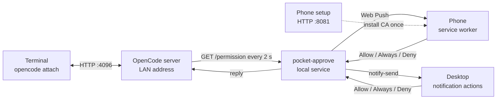

# Pocket Approve

Approve your coding agent from your pocket.

Your agent hits a permission prompt. You are on the couch, in a meeting, or three terminals deep and not sure which one is waiting. Pocket Approve sends the request to your phone and your desktop. Tap Allow once, Allow always, or Deny. The agent keeps moving.

**Status: design.** The notifier is not built yet. [REPORT.md](REPORT.md) has the verified API facts, architecture, security model, and test plan. The first build is next. Open an issue if you want to test it.

## What you get

- A desktop notification with the tool and a one-line summary, plus Allow once, Allow always, and Deny.
- A phone push over your Wi-Fi. No account and no cloud dashboard.
- One queue for every terminal attached to the shared OpenCode server. Answer once; the prompt closes.
- The terminal prompt stays as the fallback. If the notifier stops, nothing breaks.

Pocket Approve never approves anything on its own. If it cannot reach the server, it says so and leaves the terminal prompt in place.

## How it works

OpenCode sessions have to run under `opencode serve`; terminals join with `opencode attach`. A bare TUI keeps its server inside the process and cannot be reached from another device. The local service watches `GET /permission`, sends the push and the desktop notification, and replies through the OpenCode API. Phone push needs HTTPS and a service worker, so setup creates a local CA and a certificate for your LAN address.

## What it will not do

- No account and no hosted approval service.
- No port forwarding or public tunnel.
- No silent approval.

## Requirements (planned)

- Linux desktop with a notification daemon that supports actions. Tested on GNOME 50.1.
- Node.js 20 or newer.
- OpenCode 1.19 or newer.
- Android with Chrome for the first phone release. iPhone is on the roadmap.
- Laptop and phone on the same Wi-Fi. Push delivery also needs internet on both.
- A one-time local CA install on the phone.

## Roadmap

- **v1:** OpenCode, GNOME desktop actions, Android Web Push, one phone, Allow once / Allow always / Deny.
- **v1.1:** dismiss the other notification when one client answers, multiple phones, per-session routing.
- **v2:** iOS, macOS and Windows notifications, a generic CLI adapter.
- **v2.x:** Claude Code, Codex CLI, Gemini CLI, Aider.

[ROADMAP.md](ROADMAP.md) has the details and the adapter interface.

## Repository contents

- `REPORT.md`: design, verified API facts, security model, test plan.
- `ROADMAP.md`: phases and tool support.
- `SECURITY.md`: reporting and the threat model.
- No code yet.

## Safety

The OpenCode server can run commands. Treat it like a remote shell. Keep it on the LAN, set `OPENCODE_SERVER_PASSWORD`, use the notifier's token and HTTPS, and do not forward a port. [SECURITY.md](SECURITY.md) explains the model.

## Contributing

This is early. If you use OpenCode on Linux and want to test the first build, open an issue with your desktop environment and phone model. Adapter ideas are welcome, especially for agents you use every day.

## License

MIT. See [LICENSE](LICENSE).
