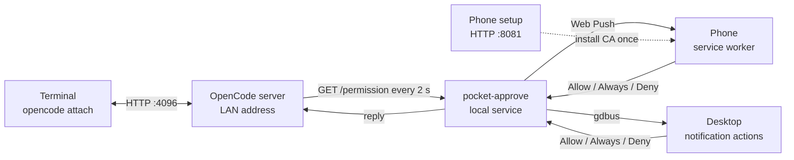

# Pocket Approve: approvals for OpenCode on your phone and desktop

Status: v1 implemented. The automated suite passes 66 of 66 tests. The live phone and desktop path has not been manually verified; the checklist near the end of this report is pending. The public repository is <https://github.com/engida32/pocket-approve>.

## The problem

OpenCode stops before it runs many shell commands, edits files, or touches paths outside the project. The prompt appears in the terminal that started the session. If you stepped away, the agent waits. If you have three terminals open, you first have to find the one holding the prompt.

Pocket Approve sends each request to your phone and your desktop. You tap Allow once, Allow always, or Deny. The terminal continues. No account, no cloud login, and no hosted approval service.

## What success looks like

- A permission request produces a desktop notification and a phone notification within a few seconds.
- The desktop notification shows the tool and a one-line summary of the command or path. It offers Allow once, Allow always, and Deny.
- The phone notification offers as many actions as the browser allows. Chromium allows two, so Allow once and Deny appear. Tapping the body opens a page that always shows all three choices.
- The terminal prompt closes when either client answers.
- When one client answers, the desktop notification closes and an open phone page drops the request on its next poll. Closing the phone notification when the desktop answers is v1.1.
- The terminal still works when the phone is offline or the notifier is stopped.
- The laptop exposes nothing outside the local network.
- The repository contains no keys, tokens, certificates, or real network addresses.

Not in v1: more than one phone, iPhone support, access from outside the LAN, a hosted service, and background dismissal of the phone notification when the desktop answers.

## What we verified

Checked against opencode 1.19.0 on Linux.

- `opencode serve --hostname <LAN_IP> --port 4096` listens on the LAN. `opencode attach http://<LAN_IP>:4096` connects a terminal to that server.
- A session started in a bare `opencode` TUI is not reachable from another device. In our test, the TUI process had no listening TCP socket. Its server runs inside the process. Use `serve` plus `attach` when the phone needs to share the same permission queue.
- `GET /permission` returns pending permission requests across sessions.
- A request can be answered with `POST /session/{sessionID}/permissions/{permissionID}` and a JSON body of `{"response":"once"}`, `{"response":"always"}`, or `{"response":"reject"}`. The server also exposes `POST /permission/{requestID}/reply` with `{"reply":"once"|"always"|"reject"}`.
- On 2026-10-25, an `always` reply stopped a second session in the same project from prompting for the same command. `GET /api/permission/saved` returned `{"data":[]}` even after the reply, both with and without `?projectID=global`. The saved endpoint is unproven. Treat `always` as at least project or server-process scoped; the exact scope is not proven and may not survive a restart.
- The server exposes permission events on its event stream.
- The server prints a warning when `OPENCODE_SERVER_PASSWORD` is not set. Without it, any device that can reach the port can use the API.
- Web Push requires a secure context. On a LAN address that means HTTPS, not `http://<LAN_IP>`.
- Mobile browsers require persistent notifications shown by a service worker. The page-only `new Notification()` constructor is not enough.
- `ServiceWorkerRegistration.showNotification` supports action buttons.
- Web Push goes through the browser vendor's push service. On Chrome for Android that is typically Google's FCM. The developer does not need a Google account; the browser creates the subscription. The laptop needs outbound internet to send a push, and the phone needs internet to receive it.
- `notify-send` 0.8.8 on this machine reports "Actions are not supported by this notifications server" and drops the action buttons, even though the daemon lists `actions` in `GetCapabilities`.
- Direct `gdbus` calls to `org.freedesktop.Notifications.Notify` with action pairs are accepted by the daemon. `gdbus monitor` sees `ActionInvoked` and `NotificationClosed`. The desktop path uses `gdbus`, not `notify-send`.
- The notification daemon on GNOME 50.1 is gnome-shell 50.1. It advertises `actions`, `body`, `body-markup`, `icon-static`, `persistence`, and `sound`. Visual confirmation of the rendered buttons is manual and still pending.

A second API client resolved pending requests with `once`, `always`, and `reject` on 2026-10-25. The full path through a real phone and a real desktop click has not been run. That checklist is pending.

## Architecture



### Components

1. **OpenCode server.** Runs on the laptop, bound to the LAN address. It owns the sessions and the permission queue. Every terminal attaches to it, so all clients see the same requests.
2. **Terminal clients.** `opencode attach http://<LAN_IP>:4096` with `-c` for the last session or `-s <id>` for a specific one. The normal terminal prompt remains the fallback.
3. **pocket-approve.** A small Node service. It holds the VAPID keys, the push subscriptions, and the access token. It polls `GET /permission`, sends a push for each new request, shows a desktop notification, serves the approval page over HTTPS, and answers requests through the OpenCode API.
4. **Desktop notifier.** A direct `gdbus` call to `org.freedesktop.Notifications.Notify` sends the notification and its action buttons to the daemon. A `gdbus monitor` watches for `ActionInvoked` and `NotificationClosed`. The service maps the action to `once`, `always`, or `reject`, and calls `CloseNotification` when the request is answered or goes stale. `notify-send` 0.8.8 is not used because it drops action buttons on the tested machine.
5. **Phone.** A browser page plus a service worker. The page handles setup and shows pending requests. The service worker receives pushes and handles notification clicks. No app install and no account.

### Why a sidecar instead of a plugin

The `permission.ask` plugin hook can change a decision before the prompt appears. A plugin could open its own HTTP server and wait for the phone. That works for one TUI process, but each additional TUI needs another port and another page, and a plugin loaded into a process cannot see requests raised by a different process.

The server model gives every terminal, the desktop, and the phone one queue. It also survives a terminal restart: the server keeps the session and the phone keeps its subscription. The cost is that sessions must be started under `opencode serve` and opened with `opencode attach`. Existing sessions are stored in the OpenCode database and can be resumed.

### Why polling

The server has an event stream, and a later version can subscribe to it. Polling `GET /permission` every two seconds is easier to reason about and recovers from a dropped connection without special code. At this scale the extra requests cost almost nothing.

### Why a local certificate authority

Web Push and service workers only run in a secure context. `http://<LAN_IP>` is not one. There are two ways to get HTTPS on a LAN address:

1. A public certificate for a domain that resolves to the laptop's LAN address. This needs a domain, DNS control, and a certificate renewal path.
2. A local CA and a server certificate with the LAN IP in `subjectAltName`. The phone trusts the CA once.

This design uses the second option. The CA private key stays on the laptop. The setup page serves only the CA certificate and installation instructions.

## Data flow

1. A tool call matches a permission rule with action `ask`.
2. OpenCode stores a permission request and shows the terminal prompt.
3. pocket-approve polls `GET /permission`. It remembers the ids it has already pushed.
4. For a new id, it sends a Web Push and starts a desktop notification. Both show a short summary: the tool name and the command or path, truncated to one line.
5. The desktop notification offers Allow once, Allow always, and Deny. The phone notification offers as many as the browser allows; Chromium shows Allow once and Deny. Tapping the phone notification opens the approval page, which always offers all three.
6. The decision goes to pocket-approve over HTTPS with the access token.
7. pocket-approve calls the OpenCode permission endpoint with `once`, `always`, or `reject`.
8. OpenCode publishes the reply. The terminal prompt closes, the desktop notification closes, and an open phone page drops the request on its next poll. The phone notification itself stays until it is tapped or replaced. Background cross-client dismissal is v1.1.

"Allow always" uses OpenCode's saved permission path. The saved list carries a project id, so the rule should apply to that project, not every project on the machine. In the 2026-10-25 probe, a second session in the same project did not prompt again, but `GET /api/permission/saved` returned no entry. The exact scope is therefore unproven. It is at least project or server-process scoped, and it may not survive a server restart.

The notifier never decides on its own. If it cannot reach the server, it shows the error on the phone page and leaves the terminal prompt in place.

## Security

The OpenCode server can run commands. Treat it as a remote shell, not a status page.

- Bind the server and the notifier to the LAN address, not `0.0.0.0`. On a machine with a VPN interface such as Cloudflare WARP, `0.0.0.0` also listens there.
- Set `OPENCODE_SERVER_PASSWORD` when the phone feature is enabled. Without it, any device on the Wi-Fi can call the API directly, bypassing the notifier's token.
- Give the notifier a random token. The setup page puts it in the URL fragment, which browsers do not send to the server. The page stores it and sends it as a bearer token. The service worker reads it from IndexedDB when a notification action fires.
- Use HTTPS for the notifier. Without TLS, a device on the same Wi-Fi can read the token and the OpenCode password.
- The notification body shows the command or path. That is useful at your desk and visible to anyone who can see the screen. On the phone, the same text can appear on the lock screen. A later setting will send a generic title for public places.
- Do not forward a port or put the server on a public tunnel. If you need access from outside the LAN, use a VPN and add authentication first.
- Keep the VAPID private key, the CA private key, the token, the subscriptions, and the OpenCode database out of git. The `.gitignore` covers them.
- The local CA is only as safe as the phone. Anyone who can install a certificate on the phone, or read its storage, can impersonate the notifier.

Threat model: someone on the same Wi-Fi, without the token or the OpenCode password. They can see that the ports exist and can reach the login page. They cannot answer a request or call the API. A person with access to the unlocked phone can answer requests, which is the point.

## Setup

These commands describe the implemented workflow. The live phone and desktop path is still on the manual checklist.

```bash
# 1. Find the LAN address.
LAN_IP=$(ip -4 route get 1.1.1.1 | awk '{for (i=1;i<=NF;i++) if ($i=="src") print $(i+1)}')
echo "$LAN_IP"

# 2. Start the shared server.
export OPENCODE_SERVER_PASSWORD='choose-a-long-password'
opencode serve --hostname "$LAN_IP" --port 4096

# 3. In another terminal, attach.
opencode attach "http://$LAN_IP:4096" -c

# 4. Start the notifier.
cd pocket-approve
npm install
npm run setup     # creates the CA, server certificate, VAPID keys, and token
npm start
```

`npm start` runs `node server.mjs`. Run `node server.mjs` directly if you prefer.

The desktop notifier needs `gdbus` from GLib, which a GNOME desktop already has. It does not use `notify-send`; version 0.8.8 drops action buttons here. GNOME and KDE both ship a notification daemon that supports actions. Other desktops may need a different adapter.

Phone setup:

1. Open `http://<LAN_IP>:8081` and install the CA certificate. On Android the menu is usually Settings, Security, Encryption and credentials, Install a certificate, CA certificate. The exact name varies by version.
2. Open the approval URL printed by `npm run setup`. It looks like `https://<LAN_IP>:8443/#token=...`.
3. Allow notifications when the browser asks.
4. Send a test notification and confirm that it arrives.

Desktop setup:

1. Run the notifier's test command. Confirm that the desktop notification shows the summary and all three actions. The notifier calls `gdbus` directly. Do not use `notify-send` as the test; version 0.8.8 drops the buttons here.
2. Answer from the desktop and confirm the terminal prompt closes.

## Repository layout

```
personal-works/            local workspace and repository root
  README.md
  REPORT.md
  ROADMAP.md
  SECURITY.md
  LICENSE
  .gitignore
  pocket-approve/          implementation
    package.json
    server.mjs
    lib/opencode.mjs
    lib/push.mjs
    lib/tls.mjs
    lib/desktop.mjs
    lib/adapters/opencode.mjs
    public/index.html
    public/sw.js
    scripts/setup.mjs
    test/
```

The repository root is the existing `personal-works` workspace. The `.gitignore` tracks only this project's files, so the other folders in the workspace are not published. The GitHub repository is named `pocket-approve`; the local folder name is historical.

## Test plan

The automated suite covers the units. The manual checklist below has not been run end to end.

1. **Round trip without a phone.** Start the server, create a session with `opencode run` or the API, trigger a `bash` permission, read `GET /permission`, reply with `once`, and confirm the tool ran. Repeat with `reject` and confirm it did not.
2. **Allow always.** Reply with `always`, trigger the same request again, and confirm that OpenCode does not ask. Check `GET /api/permission/saved`. The 2026-10-25 probe returned no entry, so record whether it appears and what scope it shows. Repeat from a second project and confirm the rule does not leak.
3. **Desktop notification.** Confirm the summary text, the three actions, and that the selected action answers the request. Confirm that dismissing the notification leaves the terminal prompt in place.
4. **Notification delivery.** Subscribe a desktop browser first, then the phone. Confirm a push arrives and that the service worker receives it.
5. **Action buttons on the phone.** Confirm Allow once and Deny answer the request from the notification without opening the page. Confirm Allow always works on the page. Confirm the fallback page path works when actions are unavailable.
6. **Cross-client dismissal.** Open the same request on the desktop and the phone. Answer on one. Confirm the desktop notification closes and the open phone page drops the request on its next poll. The phone notification itself may stay; closing it from the desktop is v1.1.
7. **Fallback.** Stop the notifier and confirm the terminal prompt still works. Disconnect the phone and confirm the request stays pending.
8. **Auth.** Confirm the notifier rejects a missing or wrong token, and that the OpenCode API rejects a wrong password.
9. **TLS.** Confirm Chrome on the phone accepts the certificate after the CA install, and that the setup page does not serve any secret.
10. **Restart.** Restart the notifier and the server. Confirm subscriptions survive and stale pending ids do not produce duplicate pushes.

Status: pending for the user. The automated suite passes 66 of 66 tests. It does not exercise a real phone, a real desktop click, phone trust of the CA, or a live OpenCode server.

## Limitations

- Two-second polling adds latency. A push typically arrives within a few seconds.
- v1 handles one phone. More phones need a subscription list and a way to show who answered.
- iPhone is out of scope for v1. Web Push on iOS has extra requirements and needs its own testing.
- The phone and the laptop must be on the same Wi-Fi for the approval page. Push delivery also needs internet on both devices.
- Desktop action buttons depend on the notification daemon and on `gdbus`. The tested target is GNOME 50.1. Visual confirmation of the rendered buttons is still pending. KDE and other desktops may render actions differently.
- Phone notification actions are capped by `Notification.maxActions`. Chromium allows two, so Allow once and Deny appear in the notification and Allow always stays on the page. The page always offers all three.
- Full cross-client dismissal is v1.1. v1 closes the desktop notification when a request is answered through the sidecar and drops answered requests from an open phone page. It does not close the phone notification when the desktop answers.
- `always` is at least project or server-process scoped in the 2026-10-25 probe. `GET /api/permission/saved` returned no entry, so the exact scope is unproven and may not survive a restart.
- The notifier is a separate process. It must be started after the OpenCode server, and it must be restarted if the token or keys change.

## Beyond OpenCode

The approval queue does not have to know which agent produced the request. The roadmap splits the service into a core and a set of adapters:

```ts
type Decision = "once" | "always" | "reject";

interface ApprovalSource {
  name: string;
  list(): Promise<Request[]>;
  reply(id: string, decision: Decision): Promise<void>;
}
```

OpenCode is the first adapter. The roadmap covers a generic command-line adapter and, after that, hooks or wrappers for other agents. [ROADMAP.md](ROADMAP.md) has the phases and the current status.

## Open questions

- License holder. The draft uses `engida32`.
- Should the notifier use the event stream instead of polling?
- How should `always` behave when the same command appears in a different project or after a restart? The 2026-10-25 probe suggests project or server-process scope, but the saved endpoint returned nothing.
- Is iOS worth the extra setup for v2?
- Which desktop environments should the first release support beyond GNOME?

## License

MIT. See `LICENSE`.
